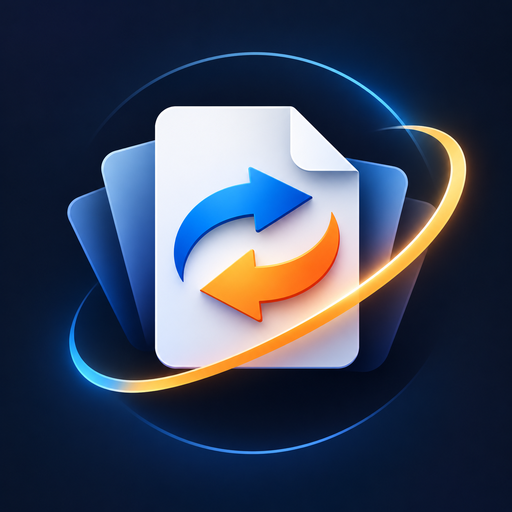

  

<h1 align="center">justconvertit</h1>

<strong>Local file conversion. One floating wheel. Nothing leaves your machine.</strong>

justconvertit is a small always-on-top desktop orb: drop a file on the hub, drag toward a format pad, and get a new file next to the original. No accounts, no uploads, no telemetry.

---

## Why it exists

Most converters either bury you in a website form or ship a bloated suite. justconvertit stays out of the way: a single radial control that only shows what that file can become, then gets out of your way.

| | |
|---|---|
| **Offline-first** | Core conversions work with no network after install |
| **Private by design** | Files never leave the device |
| **One-time install** | No in-app updater, subscriptions, or login |
| **Safe outputs** | New names by default — originals stay untouched |

---

## How it works

1. Click the center (or drop a file) to load
2. Pads appear for formats and actions that apply
3. Drag from the hub to a pad — or click the pad
4. Conversion runs in the background; cancel anytime

Optional tools on your system (LibreOffice, FFmpeg) unlock richer Office and audio/video paths when present. Without them, portable core conversions still work.

---

## What it converts

**Images** — PNG ↔ JPEG ↔ WEBP · open BMP/TIFF · crop · image → PDF  

**Documents & text** — TXT ↔ MD · HTML → TXT / MD / PDF / DOCX · DOCX → MD / PDF / images ZIP · JSON, CSV, XLSX · PPTX text · PDF extract / pages / images  

**PDF** — text extract · page render · pages → ZIP · rotate · compress · merge  

**Media** *(with FFmpeg)* — WAV ↔ MP3 · video → MP3 · GIF ↔ MP4 · frame exports  

Full matrix: [docs/CONVERSION_MATRIX.md](docs/CONVERSION_MATRIX.md)

---

## Platforms

| Platform | Artifact |
|----------|----------|
| **Windows** | Setup installer (Start menu launch) |
| **Ubuntu / Debian** | `.deb` package (app menu launch) |

Install guide: [docs/INSTALL.md](docs/INSTALL.md) · platform notes: [docs/PLATFORMS.md](docs/PLATFORMS.md)

---

## Privacy & security

- No cloud APIs for conversion  
- No accounts or licensing servers  
- No phone-home update checks  

Details: [docs/PRIVACY.md](docs/PRIVACY.md) · [docs/SECURITY.md](docs/SECURITY.md) · [docs/PRODUCT.md](docs/PRODUCT.md)

---

## Docs

| Doc | For |
|-----|-----|
| [INSTALL](docs/INSTALL.md) | End-user install & uninstall |
| [CONVERSION_MATRIX](docs/CONVERSION_MATRIX.md) | Exact supported paths |
| [WINDOWS](docs/WINDOWS.md) | Windows build & packaging |
| [RELEASE](docs/RELEASE.md) | Reproducible release builds |
| [ARCHITECTURE](docs/ARCHITECTURE.md) | Internals |
| [PROJECT_STATUS](docs/PROJECT_STATUS.md) | Current status |

---

## License

MIT — see [LICENSE](LICENSE).  
Third-party notices: [docs/THIRD_PARTY_NOTICES.md](docs/THIRD_PARTY_NOTICES.md)
